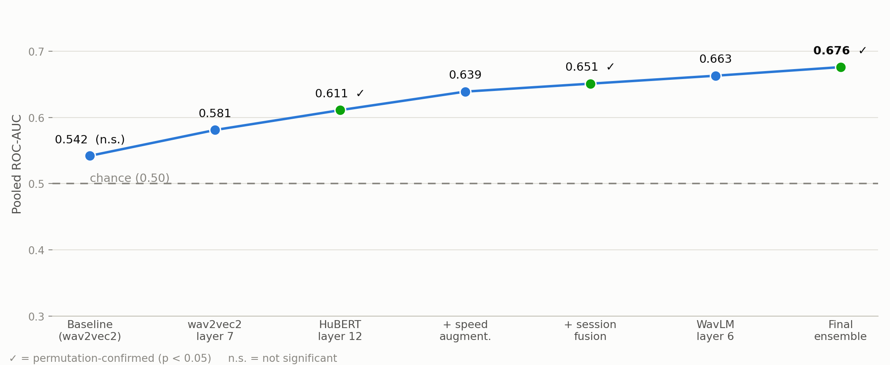
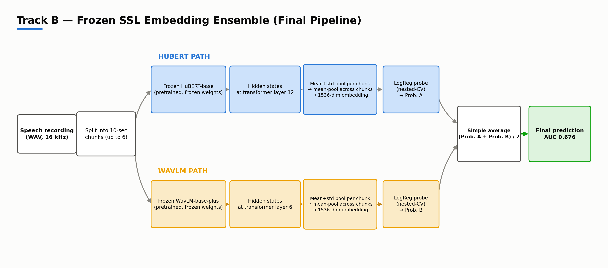

# Speaker-Independent Speech Fatigue Detection with Frozen SSL Embeddings

Binary classification (`fatigued` vs. `non_fatigued`) of short speech recordings, evaluated
**speaker-independently**: a 14-participant, 280-recording corpus, Leave-One-Speaker-Out (LOSO)
cross-validation grouped by `participant_id`.

**Final result:** `Average(HuBERT layer 12, WavLM layer 6)` → pooled ROC-AUC **0.676**,
95% CI **[0.614, 0.726]** (participant-level bootstrap), permutation **p = 0.001**.
Starting point was a near-chance wav2vec2 baseline (AUC 0.542, p = 0.19).



## Approach

Frozen self-supervised speech encoders → mean+std pooled embeddings → regularized linear classifier,
explored one variable at a time over a ten-day search:

| Stage | Pooled AUC | 95% CI | Note |
|---|---|---|---|
| Baseline (wav2vec2-base, last layer) | 0.542 | [0.466, 0.621] | permutation p = 0.19 |
| wav2vec2 layer 7 (best of 13) | 0.581 | [0.507, 0.634] | marginal |
| HuBERT layer 12 | 0.611 | [0.551, 0.683] | p = 0.01 |
| TRILLsson | 0.590 | [0.535, 0.651] | runner-up |
| HuBERT L12 + speed augmentation | 0.639 | [0.576, 0.705] | |
| + session-level fusion (N=92) | 0.651 | [0.584, 0.720] | p = 0.002 |
| WavLM-base-plus layer 6 | 0.663 | [0.600, 0.710] | |
| WavLM L6 + speed / pitch / mixup augmentation | ≤ 0.655 | – | no gain for WavLM |
| **Average(HuBERT L12, WavLM L6)** | **0.676** | **[0.614, 0.726]** | **p = 0.001** |

Findings worth keeping:
- Embedding **family and layer** mattered more than dimensionality tricks (PCA, mean-only pooling).
- Augmentation helped HuBERT but consistently failed WavLM (speed, pitch, mixup).
- Ensembling helps through **complementary** information, not raw individual strength: pairing WavLM with
  HuBERT's *strongest* pipeline gave a *worse* ensemble (0.666) than with the plain one (0.676).

Final pipeline:



## Evaluation protocol

- **LOSO** by `participant_id`; zero train/test participant overlap is asserted and printed at every fold.
- **Nested tuning:** inner `GroupKFold(6)` (also grouped by participant) selects hyperparameters; the
  outer test speaker never enters it. Scaling/PCA are fit inside training folds only.
- **Metric:** a single ROC-AUC pooled over all 280 out-of-fold predictions.
- **Confirmation (finalists only):** 95% bootstrap CI resampling *participants* (B≈1000), and a
  permutation test shuffling labels within each participant's sessions (500–1000 shuffles).
- A duration/activity-only baseline scored AUC 0.494, so no non-vocal confound drives the result.

## Repository layout

```
notebooks/pipeline/   Feature-extraction and evaluation notebooks, one pair per experiment day
notebooks/executed/   The same experiments run on Kaggle, with saved outputs
assets/               Figures
data/                 Dataset description and a 6-row labels sample (no audio)
```

Notebooks were run on Kaggle (GPU for extraction). Kaggle input paths inside them point at the
author's own uploaded dataset and must be changed to run elsewhere.

| Day | Experiment | Notebooks |
|---|---|---|
| 0–3 | wav2vec2 baseline, PCA/pooling/fusion, 13-layer sweeps (wav2vec2, HuBERT) | `01_features`, `02_train_evaluate` |
| 3 | HuBERT L12 permutation test | `permutation_test_hubert_layer12` |
| 4 | TRILLsson | `04_*` |
| 5–6 | HuBERT speed augmentation, + PCA / session fusion | `05_*`, `06_evaluate_combined` |
| 7 | WavLM-base-plus layer sweep | `07_*` |
| 8a, 9 | Augmentation on WavLM (speed, pitch-shift, mixup) | `08a_*`, `09_*` |
| 8b, 8c, 10 | Embedding fusion, ensembles, final confirmation | `08b_*`, `08c_*`, `10_*` |

## Data

The recordings are **not** included: they are voice recordings of 14 people, and redistribution
terms are not ours to set. The corpus is 280 WAV files (16 kHz mono, 147 `non_fatigued` / 133
`fatigued`; participants contribute 6–42 recordings each) with three tasks per session: read aloud,
read aloud nonsense, describe picture. See [`data/DATASET_README.md`](data/DATASET_README.md) and
[`data/labels_sample.csv`](data/labels_sample.csv) for the expected layout.

## Limitations

- **N = 14 speakers** bounds statistical power; the CI (≈ ±0.06) reflects this.
- Heavily uneven recordings per speaker make individual LOSO folds noisy.
- Many variants were tried; every result is logged, and permutation tests were reserved for finalists
  to limit multiple-comparison risk. The final ensemble was still selected on the same data it is reported on.
- Frozen SSL embeddings are not interpretable.

## Context

This was a course project in which a teammate separately studied classical acoustic features and a BLSTM
baseline on the same data. This repository contains only the SSL-embedding work above.

## Acknowledgements

Methodology follows the speaker-independent, three-task protocol of Norbury et al. (Thymia/KCL, medRxiv 2024)
and the leakage warnings of Berisha et al. (2022). Models: `facebook/wav2vec2-base`,
`facebook/hubert-base-ls960`, `microsoft/wavlm-base-plus`, Google TRILLsson.

## License

MIT for the code (see `LICENSE`). Model weights and the dataset keep their own licenses.
